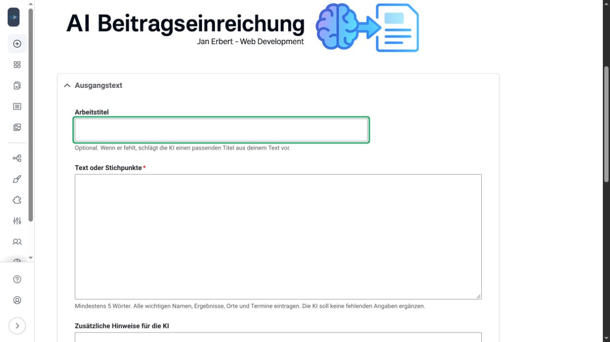
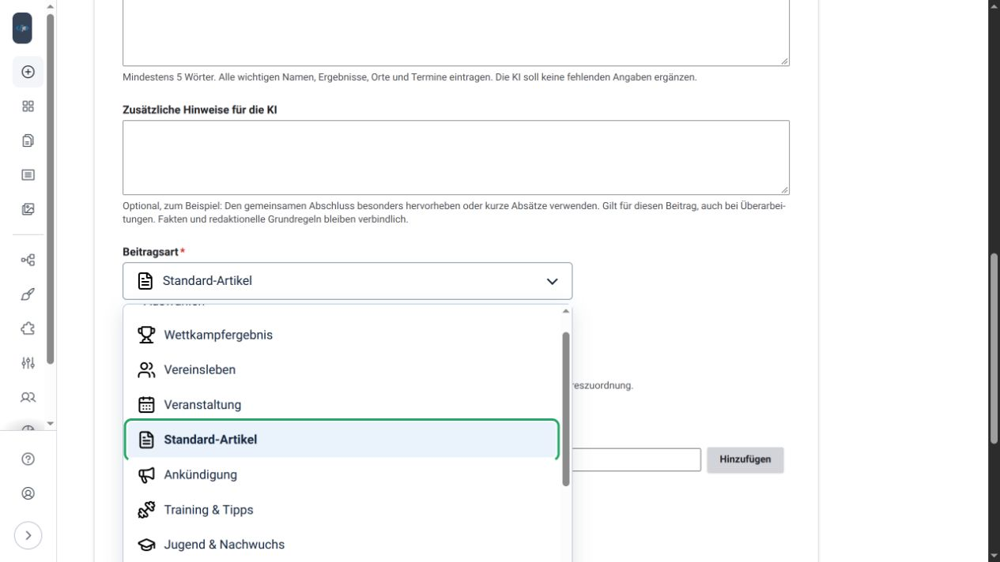

# Formular-Übersicht

Öffne **Erstellen → KI-Beitrag erstellen** oder `/admin/content/ki-beitrag`. Für den Einstieg brauchst du die [KI-, Beitrags- und Textformatrechte](benutzerrechte.md).

## Eingabefelder

| Feld | Verwendung |
| --- | --- |
| Arbeitstitel | Optional. Ohne Eingabe schlägt die KI einen Titel aus dem Text vor. |
| Text oder Stichpunkte | Pflichtfeld. Standard mindestens 30 Wörter; die Administration kann die Grenze ändern. |
| Zusätzliche Hinweise für die KI | Optional, bis 2000 Zeichen. Wünsche für diesen Beitrag, bereits bei der ersten Erstellung. Bleiben bei Überarbeitungen erhalten. |
| Beitragsart | Pflichtauswahl einer [Stilgruppe](stilgruppen.md), mit deren Erkennungszeichen. |
| Beitragsdatum | Datum und Uhrzeit, auch für nachgetragene Berichte. |
| Schlagwörter | Eigene Begriffe mit Enter, Komma oder Hinzufügen als Kacheln übernehmen. |
| Vorschautext | Eigener Kurztext. Das Feld erscheint, wenn der KI-Vorschlag dafür abgewählt ist. |
| Vorschautext von der KI vorschlagen lassen | Erstellt den Kurztext mit dem Vorschlag und blendet das manuelle Feld aus. |
| Zusätzliche Schlagwörter von der KI vorschlagen lassen | Ergänzt passende Begriffe nach den Regeln; eigene Begriffe bleiben erhalten. |

*Die abgebildeten Gruppen sind individuell konfiguriert. Neue Installationen beginnen mit drei neutralen Gruppen.*

Die Jahresanzeige folgt dem **Beitragsdatum**. Sie ist kein zusätzliches Schlagwort. Ein Jahresarchiv muss die Website selbst bereitstellen.

## Vorschau und Überarbeitung

**KI-Vorschlag erstellen** zeigt Titel, Text, Vorschautext und Schlagwörter. Wenn freigegeben, werden passende [Gestaltungsstile](symbole.md) angewendet. Jeder KI-Aufruf kann Kosten beim Anbieter verursachen.

Unter **Änderungswunsch an die KI** formulierst du eine konkrete Korrektur am vorhandenen Vorschlag. Das ist unabhängig von den zusätzlichen Hinweisen für den gesamten Beitrag. Die Verarbeitung zeigt einen Dialog mit Animation; Erfolg und Fehler haben eigene Rückmeldungen. Reduzierte Systembewegung wird berücksichtigt.

**Im Beitragseditor weiterbearbeiten** öffnet das ungespeicherte native Drupal-Formular. Dort ergänzt du Medien und prüfst den Abschluss. **Beitrag ohne KI erstellen** führt direkt in die normale Beitragserstellung, ohne KI-Anfrage.

[Zur Startseite](index.md) · Weiter: [Gute Beiträge schreiben](gute-beitraege.md)

Am Formularende öffnen **Beitrag erstellen** und **Gute Beiträge schreiben** die passenden Seiten im Drupal-Wiki in einem neuen Tab. Deine bisherigen Eingaben bleiben im Formular.
