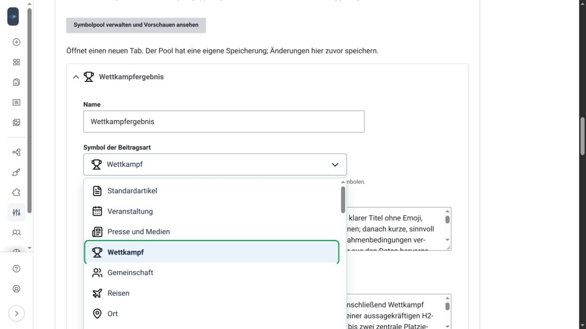
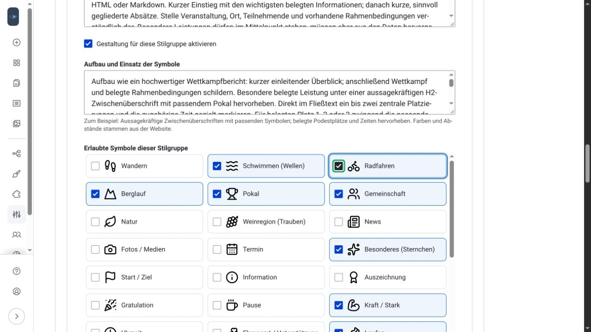

# Stilgruppen verwalten

Eine Stilgruppe beschreibt eine Beitragsart: Name, Erkennungszeichen, Textvorgaben und optional Gestaltungsregeln. Die Redaktion wählt sie im Formular; die Administration pflegt sie unter [Einstellungen](einstellungen.md).

## Die drei Startgruppen

| Name | Symbol | Zweck |
| --- | --- | --- |
| Standardartikel | `file-text` | Sachlicher Artikel mit klarem Einstieg und kurzen Absätzen. |
| Veranstaltung | `calendar-days` | Ankündigung oder Rückblick anhand der tatsächlich gelieferten Informationen. |
| Presse und Medien | `newspaper` | Präziser Bericht; vorhandene Quellen und Zitate korrekt zuordnen. |

Diese Grundausstattung gilt für **Neuinstallationen**. Updates ersetzen keine vorhandenen eigenen Gruppen. Die zusätzliche KI-Gestaltung bleibt standardmäßig deaktiviert.

## Erstellen und bearbeiten

Öffne eine vorhandene Gruppe oder **Neue Stilgruppe**. Trage einen verständlichen Namen und konkrete **Stilvorgaben** ein. Interne Kennungen werden automatisch verwaltet und nicht als Eingabefeld angezeigt. Das Umbenennen des sichtbaren Namens verändert die Zuordnung nicht.

Wähle unter **Symbol der Beitragsart** das Erkennungszeichen. Die Liste zeigt lokale Vorschauen. Für weitere Symbole **Anderen Lucide-Namen eingeben** wählen und einen bekannten Namen wie `search` eintragen. Das Modul prüft ihn beim Speichern gegen den lokalen Katalog. Das Kennzeichen erscheint im Gruppenkopf und im Beitragsformular; es ist unabhängig von Symbolen im Beitragstext.



Gruppen lassen sich duplizieren, verschieben und entfernen. Diese Aktionen ändern zunächst nur den Formularentwurf. **Konfiguration speichern** übernimmt die Änderungen dauerhaft. Schon gespeicherte Beiträge werden dadurch nicht umgeschrieben.

## Gute Stilvorgaben

> Schreibe sachlich und anschaulich. Nutze kurze Absätze und klare Zwischenüberschriften. Übernimm alle gelieferten Namen und Ergebnisse unverändert. Ergänze keine fehlenden Fakten und verwende keine Emojis.

Der Grundstil gilt zusätzlich. Prüfe insbesondere importierte Vorgaben auf Widersprüche, alte Emoji-Anweisungen oder übermäßige Hervorhebungen. Pro Gruppe sind höchstens 10.000 Zeichen vorgesehen, im Grundstil 20.000.

## Gestaltung je Stilgruppe

Mit globaler Freigabe und **Gestaltung für diese Stilgruppe aktivieren** kann die KI einen gezielten Aufbau verwenden. **Aufbau und Einsatz der Symbole** beschreibt, wann Symbole, Zwischenüberschriften und Tabellen passen.

**Erlaubte Symbole dieser Stilgruppe** sind Checkbox-Kacheln mit Vorschau. Mehrere Häkchen brauchen keine Strg-Taste. Zusätzliche Schalter erlauben eine hervorgehobene Einleitung und eine gestaltete Ergebnistabelle. Die individuelle KI-Freigabe im Symbolpool bleibt erforderlich.



Keine Regel ergänzt fehlende Fakten oder berechnet unbekannte Rangfolgen. Prüfe Vorschau und Ergebnisse weiterhin. Weitere Erklärung: [Symbole und Gestaltung](symbole.md).

## Import und Export

Unter **Stilgruppen importieren / exportieren** eine JSON-Datei auswählen oder JSON einfügen, **Import prüfen**, Vorschau prüfen und bewusst übernehmen. Namenskonflikte erhalten Zusätze. Bestehende Gruppen werden ergänzt, nicht überschrieben. Abschließend die Konfiguration speichern.

Unterstützt sind die Originalformate in Version 1:

- `ai-beitragseinreichung-style-group` für eine Gruppe.
- `ai-beitragseinreichung-style-groups` für mehrere Gruppen.

```json
{
  "type": "ai-beitragseinreichung-style-group",
  "version": 1,
  "data": {
    "label": "Ergebnisbericht",
    "stil": "Sachlich und übersichtlich. Keine erfundenen Angaben.",
    "ziel": "Die gelieferten Ergebnisse verständlich darstellen."
  }
}
```

Grenzen: höchstens 500 KB je Import und insgesamt maximal 50 Gruppen. Exporte enthalten den **gespeicherten** Stand, einzeln oder gesammelt. Die JSON-Grundstruktur bleibt mit dem Original kompatibel. Optionale Drupal-Metadaten erhalten Erkennungszeichen und Gestaltungsregeln; alte Exporte bekommen ein neutrales Artikelzeichen.

Der Export enthält keine API-Schlüssel, Rollen, Begriffspools oder vollständigen Website-Einstellungen. Auch Einträge aus dem **Symbolpool selbst** werden nicht mitexportiert. Auf der Zielinstallation passende Poolkennungen einrichten; fehlende Einträge werden nicht von der KI verwendet.

[Zur Startseite](index.md) · Weiter: [Symbole und Gestaltung](symbole.md)
