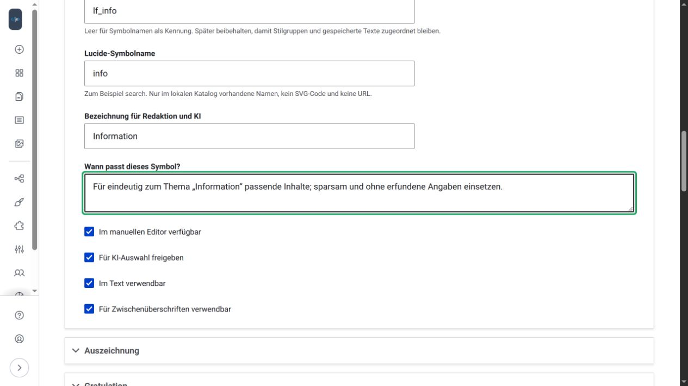

# Symbole und Gestaltung

Das Modul unterscheidet zwei Dinge:

| Symbolart | Verwendung |
| --- | --- |
| Erkennungszeichen einer Beitragsart | Ein Symbol vor dem Gruppennamen in Einstellungen und Auswahl. Für jede Gruppe änderbar. |
| Symbolpool für Beiträge | Freigegebene Symbole für Textstellen und H2-Zwischenüberschriften, manuell oder durch die KI. |

Ein Gruppensymbol aktiviert keine Symbole im Beitrag. Die [Stilgruppen-Seite](stilgruppen.md) erklärt seine Auswahl.

## Woher die Symbole kommen

Der lokale Lucide-Static-Katalog 1.58.0 enthält 2159 SVG-Grafiken und vorbereitete PNG-Versionen. Er liegt komprimiert im Modul. Drupal lädt **keine Symbole live von Lucide und benötigt kein CDN**. SVGs dienen der Oberfläche und Webdarstellung; PNGs werden für E-Mails lokal eingebettet. Lizenzhinweise bleiben unter `assets/lucide/` erhalten.

Updates des Katalogs erfolgen mit einem Modul-/Entwicklungsupdate. Ein neuer Symbolname muss im mitgelieferten Bestand vorhanden sein. Freie Bildadressen und SVG-Uploads sind nicht vorgesehen.

## Symbolpool verwalten

Öffne **Symbolpool verwalten und Vorschauen ansehen** aus den Einstellungen oder `/admin/config/content/je-ai-submission/symbols`. Das vorhandene Einstellungsrecht ist erforderlich. Die Poolseite speichert separat; Änderungen im anderen Tab vorher sichern.

| Feld | Bedeutung |
| --- | --- |
| Feste Kennung | Stabile Zuordnung für Gruppen und gespeicherte Texte; leer übernimmt den Symbolnamen. Später möglichst beibehalten. |
| Lucide-Symbolname | Ein lokaler Name wie `info`, `search` oder `bike`. |
| Bezeichnung für Redaktion und KI | Verständlicher Begriff, beispielsweise Information oder Radfahren. |
| Wann passt dieses Symbol? | Fachlicher Einsatz, Abgrenzung und gegebenenfalls Ausschlüsse. |
| Im manuellen Editor verfügbar | Bietet das Symbol in CKEditor 5 unter Stile an. |
| Für KI-Auswahl freigeben | Erlaubt die KI-Verwendung zusätzlich zur Gruppenfreigabe. |
| Im Text verwendbar | Erlaubt die Hervorhebung einer konkreten Textstelle. |
| Für Zwischenüberschriften verwendbar | Erlaubt ein Symbol an einer H2-Überschrift. |

Mindestens Text oder Überschrift muss erlaubt sein. Bis zu 80 Symbole sind möglich. Neue Einträge sind zunächst manuell freigegeben und für die KI gesperrt.

**Symbolnamen und Vorschauen prüfen** validiert lokal und zeigt die Grafik, ohne KI-Aufruf und ohne dauerhafte Speicherung. Erst **Konfiguration speichern** übernimmt den Pool und synchronisiert seine Stile mit dem konfigurierten CKEditor-Textformat. Fremde Editorstile bleiben erhalten.

Die neutrale Startauswahl besteht aus **Information** und **Besonderes**. Zusätzliche Sport-, Branchen- oder Veranstaltungsmotive sind eigene Website-Konfiguration.

## Die KI gezielt freigeben

1. In den Einstellungen **Gestaltungsstile durch die KI verwenden** aktivieren.
2. Die Gestaltung für die gewünschte Stilgruppe aktivieren.
3. In dieser Gruppe die passenden Symbol-Kacheln anhaken.
4. Diese Symbole auch im Pool für die KI freigeben und passende Einsatzorte erlauben.
5. Die Aufbauvorgaben der Gruppe formulieren und speichern.

Die KI erhält nur den so erlaubten Vorrat, keine freie Symbolsuche. Sie liefert begrenztes Markdown und separate Zuordnungen zu genauen Textstellen. Das Modul übernimmt nur erlaubte, vorhandene Ziele. Vorschau und Editor verwenden denselben Renderer. Ein Symbol ist keine Bestätigung einer Platzierung oder anderer Fakten.

## Manuell im Editor verwenden

Im normalen CKEditor eine passende Textstelle oder H2 markieren und einen angebotenen Stil wählen. Textformat und Berechtigungen bleiben maßgeblich. Für die KI erlaubte, manuell aber ausgeblendete Stile bleiben beim Bearbeiten über native General-HTML-Support-Konfiguration erhalten.

Die globale KI-Gestaltung darf ausgeschaltet sein, während die manuelle Auswahl verfügbar bleibt. Bereits gespeicherte Inhalte werden durch das Abschalten der KI nicht entfernt. Das Entfernen oder Umbenennen von Poolkennungen kann ihre spätere Darstellung und Zuordnung dagegen verändern; bestehende Inhalte vorher berücksichtigen.

## Farben, Website-Stile und Mail

Das Modul bringt eine neutrale Darstellung mit. Eine Website kann ihre eigenen Klassen, Farben und passende Maildarstellung über den [Gestaltungsadapter](entwicklung.md#gestaltungsadapter-fur-websites) verwenden. Diese Gestaltung wird nicht als HTML von der KI erfunden.

Moduleigene Symbole werden in Benachrichtigungen als lokale PNG-/CID-Bestandteile angezeigt. Individuelle Website-Klassen benötigen eine passende Mailabbildung im Hauptprojekt. Beitragsfotos folgen den getrennten [Mailbild-Regeln](beitrag-einreichen.md#7-mail-und-versandstatus).

[Zur Startseite](index.md) · Weiter: [Benutzerrechte](benutzerrechte.md)
